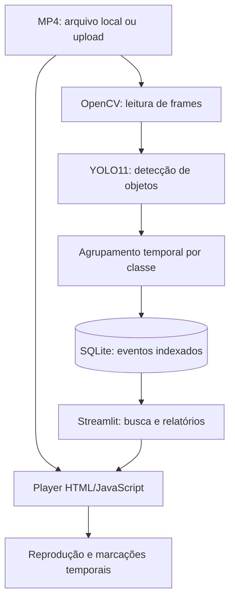

<div align="center">

# CFTV — Central Inteligente

### Indexação e recuperação de eventos em vídeos de segurança com visão computacional

**Python · Streamlit · YOLO11 · OpenCV · SQLite**


**Projeto acadêmico de TCC · Protótipo local em desenvolvimento**

[Funcionalidades](#-funcionalidades) · [Arquitetura](#-arquitetura) · [Instalação](#-como-executar) · [Testes](#-testes) · [Documentação](#-documentação-técnica)

</div>

---

## Sobre o projeto

O **CFTV — Central Inteligente** é um sistema de apoio à análise de gravações de câmeras de segurança. Ele utiliza **YOLO11** e **OpenCV** para identificar classes de objetos em vídeos, agrupa detecções em eventos com intervalos de tempo e permite pesquisá-los e reproduzi-los em uma interface web criada com **Streamlit**.

A proposta é facilitar a localização de trechos relevantes em gravações sem exigir que o usuário assista manualmente ao vídeo inteiro.

> **Escopo atual:** detecção das classes **pessoa**, **carro** e **motocicleta** na indexação principal. O diagnóstico rápido também considera **bicicleta**. Os eventos descrevem a presença de uma classe em um intervalo, e **não** o rastreamento de indivíduos.

## Funcionalidades

| Módulo | O que oferece |
| --- | --- |
| **Visão geral** | Indicadores, gravações disponíveis e eventos indexados |
| **Upload de vídeos** | Adição de arquivos MP4 à biblioteca local pela interface |
| **Teste rápido de IA** | Análise amostrada de frames com contagens de caixas detectadas, sem alterar o banco |
| **Indexação completa** | Processamento de gravações com YOLO e gravação de eventos no SQLite |
| **Pesquisa de eventos** | Filtros por objeto, vídeo e intervalo de tempo; opções de ordenação |
| **Player personalizado** | Reprodução a partir do evento, marcações coloridas e legenda na linha do tempo |
| **Relatórios** | Gráficos por classe/gravação, tabela e exportação CSV |
| **Testes automatizados** | Cobertura de busca, manipulação de vídeo, streaming, indexação, diagnóstico e upload |

## Arquitetura



O projeto separa **interface** (`views/`), **componentes reutilizáveis** (`components/`) e **regras/serviços** (`services/`), mantendo scripts específicos para indexação e diagnóstico.

<details>
<summary><strong>Estrutura resumida do repositório</strong></summary>

```text
TCC/
├── app.py                      # Entrada do Streamlit
├── indexar_video.py            # Indexação completa por terminal
├── diagnostico_motos.py        # Diagnóstico de classes/confiança
├── gerar_eventos.py            # Conversão legada CSV → eventos
├── criar_banco.py              # Importação de eventos CSV para SQLite
├── assets/                     # Estilos CSS
├── components/                 # Sidebar, cards e player
├── views/                      # Visão geral, busca, vídeos e relatórios
├── services/                   # Busca, banco, streaming, indexação, upload
├── tests/                      # Testes automatizados
├── docs/                       # Documentação técnica e decisões
└── videos/                     # MP4 locais (não versionados)
```

</details>

## Tecnologias

| Tecnologia | Papel |
| --- | --- |
| **Python** | Lógica do sistema e integração dos módulos |
| **Streamlit** | Interface web local e componentes interativos |
| **Ultralytics YOLO11n** | Inferência de detecção de objetos em frames |
| **OpenCV** | Leitura de vídeos e extração de frames |
| **SQLite** | Persistência de eventos com classe e intervalo temporal |
| **HTML, CSS e JavaScript** | Estilo e controles personalizados de reprodução |
| **Pandas** | Tabelas e exportação de resultados |
| **unittest** | Testes automatizados com a biblioteca padrão do Python |

## Como executar

### Pré-requisitos

- Python **3.12** (versão de referência utilizada no desenvolvimento);
- Git e um ambiente virtual Python;
- Bibliotecas **streamlit**, **opencv-python**, **ultralytics** e **pandas**, além de suas dependências;
- Pesos pré-treinados **`yolo11n.pt`** disponíveis **localmente** na raiz do projeto.

> **Observação:** o repositório ainda não possui `requirements.txt` oficial. O comando abaixo instala as dependências principais; para maior reprodutibilidade, será necessário registrar versões e validar o ambiente.

### 1. Obter o código

```bash
git clone https://github.com/joaoxavier-profissional/TCC.git
cd TCC
```

O repositório pode exigir autorização de acesso.

### 2. Criar e ativar o ambiente virtual

No **Windows (Git Bash)**:

```bash
py -3.12 -m venv venv
source venv/Scripts/activate
```

No **Linux/macOS**:

```bash
python3 -m venv venv
source venv/bin/activate
```

### 3. Instalar dependências principais

```bash
python -m pip install streamlit opencv-python ultralytics pandas
```

> O projeto não inclui automaticamente os vídeos nem os pesos do modelo. Coloque `yolo11n.pt` na raiz e os vídeos MP4 em `videos/`, ou adicione-os pelo upload após iniciar a interface. O aplicativo precisa de um `cftv.db` local para abrir normalmente; veja a preparação inicial abaixo.

### 4. Preparar banco e pasta de vídeos

Crie a pasta `videos/`, se ainda não existir. Inicialize um banco SQLite vazio **apenas em instalações novas**, sem substituir bancos existentes:

```bash
python -c "import sqlite3; c=sqlite3.connect('cftv.db'); c.execute('CREATE TABLE IF NOT EXISTS eventos (id INTEGER PRIMARY KEY AUTOINCREMENT, video TEXT NOT NULL, classe TEXT NOT NULL, inicio TEXT NOT NULL, fim TEXT NOT NULL)'); c.commit(); c.close()"
```

**Se você já tem um `cftv.db` com eventos, mantenha o original e faça backup antes de reindexar.**

### 5. Iniciar a aplicação

```bash
streamlit run app.py
```

Acesse **http://localhost:8501** e use a aba **Vídeos** para enviar uma gravação, testar a detecção e executar a indexação completa.

## 🧠 Como funciona a indexação

1. O **OpenCV** lê os frames do vídeo.
2. O **YOLO11n** procura pessoas, carros e motocicletas com confiança mínima de **0,40**.
3. As classes presentes são consolidadas por segundo.
4. O agrupamento temporal reúne detecções da mesma classe separadas por até **2 segundos**.
5. O **SQLite** armazena os campos `video`, `classe`, `inicio` e `fim`.
6. A busca recupera eventos e o player abre o trecho associado.

**Reindexação:** ao processar novamente um vídeo, seus eventos antigos são substituídos em uma transação; os eventos de **outras gravações** são preservados.

O **teste rápido**, por sua vez, amostra aproximadamente **1 frame/segundo durante os primeiros 30 segundos** e usa confiança mínima **0,10** para investigar classes. Esse teste **não modifica** o banco e **não mede sozinho precisão ou recall**.

## 🧪 Testes

Com o ambiente ativado:

```bash
python -m unittest discover -s tests -p "test_*.py" -v
```

Os testes incluem filtros temporais, ordenação, conversão de horários, solicitações HTTP Range para vídeos locais, isolamento dos eventos por gravação, rollback de transações e validação de uploads.

> Testes automatizados não substituem a validação visual da interface nem a avaliação de precisão do modelo em vídeos anotados.

## Documentação técnica

- [Arquitetura e fundamentos para a defesa](docs/arquitetura-e-defesa.md)
- [Indexação de múltiplos vídeos](docs/indexacao-multiplos-videos.md)
- [Player com streaming local](docs/player-streaming.md)
- [Diagnóstico de motocicletas](docs/diagnostico-motos.md)
- [Upload e processamento pela interface](docs/upload-processamento-interface.md)

## Próximas etapas

- [x] Interface para consulta de eventos e relatórios
- [x] Reprodução com marcações temporais
- [x] Indexação individual de múltiplos vídeos
- [x] Upload e teste de detecção na interface
- [x] Testes automatizados das regras principais
- [ ] Medir precisão, recall e desempenho em um conjunto de vídeos anotados
- [ ] Melhorar a detecção de objetos pequenos, incluindo motocicletas
- [ ] Melhorar o acompanhamento do progresso de indexação
- [ ] Fortalecer a segurança e preparar uma possível implantação em rede
- [ ] Consolidar experimentos, resultados e documentação acadêmica

## Limitações conhecidas

- O **streaming do player** utiliza um servidor local em `127.0.0.1`, destinado ao navegador no mesmo computador.
- A aplicação atual é um **protótipo local**, sem autenticação apropriada para exposição pública.
- A indexação completa processa os frames de forma síncrona e pode consumir CPU/GPU por bastante tempo.
- A detecção de motocicletas pequenas ainda está em avaliação; reduzir a confiança pode aumentar falsos positivos.
- O repositório **não inclui** os vídeos originais, banco local ou ambiente virtual.

---

<div align="center">

### Trabalho de Conclusão de Curso

**CFTV — Central Inteligente**  
*Visão computacional aplicada à indexação e recuperação de eventos em gravações de segurança.*

Desenvolvido por [João Xavier](https://github.com/joaoxavier-profissional) e [Mateus Segur].

**Acompanhe a evolução do projeto neste repositório.**

</div>
